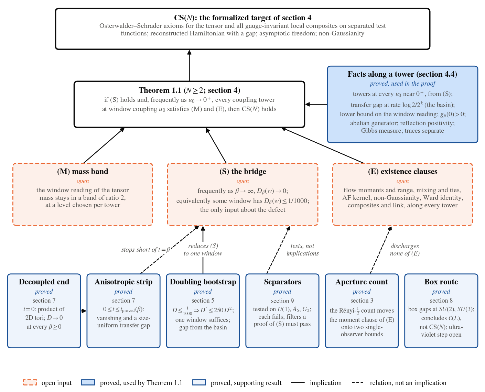

# 1. Introduction

## 1.1 The frame and what it contributes

In the frame of the Entroptics paper [Entroptics] a signal is read through a finite aperture: the aperture holds a finite number of modes, and that number is read from the spectrum of what it sees (§E-2, §E-3.1). This paper takes the frame to the continuum limit of four-dimensional $SU(N)$ lattice gauge theory. The observer reads the field through an aperture of fixed physical resolution: whatever the lattice spacing, it smooths the field over a region of fixed physical size (section 2). A finer lattice is a finer substrate beneath the same aperture, and the continuum theory is the limit of what the aperture reads.

The frame carries mathematical content in two places, one on each half of the problem.

- The window (gap side, sections 4 and 5). The doubling defect of the periodic torus, sixteen tori of side $n$ against one of side $2n$, cancels the bulk free energy exactly and counts every excited state with its multiplicity. The dyadic sides, the two-loop spacing $a_k$ and a level $u_0$ are chosen; along a coupling tower the coupling at each window is then read from the defect as the one at which it takes the value $u_0$, and the tie of $\beta_k$ to $a_k$, which carries the asymptotic-scaling content, is the open input (M).
- The count (existence side, section 3). Inside a box of fixed physical side the observer's readings form a finite screen with uncorrelated modes. One variance bound and a per-mode moment bound give every even moment of a reading through the Rényi count of order ½, with constants free of the box and the zoom.

In its own setting, a signal read through a window and a band of consecutive frequencies, the frame's central claim is proved: the aperture holds $TW/N$ modes up to a logarithm (Theorem 3.15). For the heat-smoothed screen of the Wilson field it is reduced to one inequality, the bare plaquette covariance on the box at most a fixed multiple of the one-link conditional variances of the lowest-mode field, eventually along the two-loop couplings (Theorems 3.10 to 3.12); that inequality is open (section 3.7). What Entroptics gives beyond the standard toolkit, within what is proved, is two choices that the problem itself fixes: the window of the anisotropic strip is set by a proved bound on the plane's correlation area, the area $\ell_N(\beta)$ within which its plaquette walk mixes (Theorem 7.8), which fixes the seed window of Theorem 7.12, and the order ½ of the count is forced, as the greatest order at which the single-reading moment closure holds (Theorem 3.6). Everything else proved here (the bootstrap, the strip, the box gaps, the group port, the separators and the reduction) is a statement about the Wilson measure, its transfer operator and its Osterwalder–Schrader reconstruction, and its proof uses neither an aperture nor a count.

## 1.2 The problem and the formalized target

Jaffe and Witten [JW] ask, for every compact simple gauge group, for a quantum Yang–Mills theory on $\mathbb R^4$ satisfying axioms at least as strong as the Wightman or Osterwalder–Schrader axioms [OS1], [OS2], with a mass gap $\Delta>0$. The standard route is the reflection-positive Wilson lattice measure [Wilson], [OsterwalderSeiler], [FILS1]. At strong coupling its infinite-volume theory and gap are classical [OsterwalderSeiler], [Seiler82]; at weak coupling the ultraviolet stability of the existence half is the subject of Bałaban's program [Balaban84a]–[Balaban89b], and the gap half is open.

The target of this paper is a proposition $\mathrm{CS}(N)$, stated clause by clause in section 4. Informally: there are couplings $\beta_k\to\infty$ whose measured tensor mass lies, for all large $k$, in a band $[c\,a_k,2c\,a_k]$ around the two-loop dyadic spacing $a_k$; a configuration flow of fixed physical range; and a reflection-closed class of local fields, such that the periodic Wilson states read through the flow have limit Schwinger functions along a fixed ultrafilter satisfying, on separated test functions, the Osterwalder–Schrader axioms for the renormalized tensor $T_{\mu\nu\rho\sigma}\sim\operatorname{tr}F_{\mu\nu}F_{\rho\sigma}$ and for all gauge-invariant local composites; the reconstructed Hamiltonian has a gap on the vacuum complement, on the tensor's space and on the space of all local fields; the trace two-point function has the short-distance form of asymptotic freedom; the connected three-point function of the trace is non-zero; and the translation Ward identity holds. It differs from [JW] in five ways: only $SU(N)$; separated test functions; one fixed ultrafilter; the Wightman reconstruction argued, not formalized; and an existentially chosen flow and coupling sequence. $\mathrm{CS}=\forall N\ge2:\mathrm{CS}(N)$.

## 1.3 The headline

Write $Z_\beta(n)$ for the partition function of the $SU(N)$ Wilson action on the periodic four-torus of side $n$ ($\beta=\beta_W/2$, $\beta_W=2N/g_0^2$), and $D_\beta(w)=16\log Z_\beta(2^w)-\log Z_\beta(2^{w+1})$ for the defect at window $w\ge1$. The basin is the region $D_\beta(w)\le1/1000$, and a window in it is a seed: by the doubling bootstrap of section 5 a seed forces $D_\beta(w')\to0$ along all later windows and a transfer gap of rate $\log2/2^w$. A coupling tower at window coupling $u_0$ is a sequence $\beta_k\to\infty$ with $D_{\beta_k}(k)=u_0$ for all large $k$. Let $E(x)=P_{01}(x)-P_{23}(x)$ be the tensor reading, $P_{\mu\nu}(x)$ the Wilson density of the plaquette at $x$ in the $(\mu,\nu)$ plane, and $m(\beta)\in[0,\infty]$ its measured mass under the periodic state, the supremum of the exponential decay rates of its connected correlation; $a_k=a(1)/2^{k+1}$, with $a(1)$ the two-loop running spacing (section 8) evaluated at $\beta=1$ ($\beta_W=2$).

> Theorem 1.1 (the reduction; section 4). Let $N\ge2$. Suppose
>
> (S) frequently as $\beta\to\infty$, $D_\beta(w)\to0$ as $w\to\infty$;
>
> and suppose that, frequently as $u_0\to0^+$, every coupling tower $(\beta_k)$ at window coupling $u_0$ satisfies
>
> (M) there is $c>0$ with $c\,a_k\le m(\beta_k)\le2c\,a_k$ for all large $k$;
>
> (E) the existence clauses of $\mathrm{CS}(N)$ along $(\beta_k)$: a flow with factorial cube-moment bounds for the symmetrized plaquette class and a physical range; a renormalized tensor with its symmetries, ties and normalizations; a two-point kernel with the asymptotic-freedom coefficient; non-Gaussianity; the Ward identity; the composites with their data, Osterwalder–Schrader clauses and link to the reconstruction; and convergence of the mixed readings, with each limit equal to the inner product of the corresponding reconstructed vectors.
>
> Then $\mathrm{CS}(N)$ holds.

(S) is the gap input and (M) ties each tower's coupling to the two-loop spacing $a_k$. The proof: (S) gives towers at every small $u_0$; at $u_0\le1/1000$ each window of a tower is a seed, so the periodic transfer has a gap at lattice rate $\log2/2^k$, a fixed rate in units of $a_k$; (M) makes the tower a measured tower of the target; and the reconstruction through the flow of (E) carries the gap to the Hamiltonian (section 4.3). The theorem derives the gap side and several Osterwalder–Schrader clauses (the Hamiltonian gap, the spectral gaps on the tensor's space and on all local fields, OS2 and OS4, the link of the reconstruction to the lattice vectors, the non-zero vectors orthogonal to the vacuum) from (S) and (M), using the moment bound and range of the flow that (E) supplies, and takes the remaining clauses from (E). It is per $N$, and nothing shows the three inputs consistent with one another. Figure 1.1 draws its structure.

Figure 1.1. The structure of Theorem 1.1. The target $\mathrm{CS}(N)$ follows from the open inputs (S), (M) and (E). The proof uses the facts proved along a tower (section 4.4). The supporting results are proved as stated: the bootstrap (section 5) reduces (S) to one window; the decoupled end and the strip (section 7) prove vanishing off the isotropic line and stop short of $t=\beta$; the separators (section 9) are negative results; the count (section 3) moves the moment clause of (E) onto a per-mode bound, a count bound and bounds on the variance and mean in physical units (Theorem 3.9); the box route (section 8) concludes a weaker statement $\mathcal C(L)$. Dashed arrows are relations, not implications.

## 1.4 What is proved without open inputs

| result | where |
|---|---|
| the doubling bootstrap: $D_\beta(w)\le1/1000\Rightarrow D_\beta(w+1)\le250\,D_\beta(w)^2$ and vanishing; a transfer gap of rate $\log2/n$ uniform in the torus size from one seed; the periodic gap of the infinite-volume state from one window; the fork $D(w+1)\le30\,Y(w)(e^{8D(w)+2D(w+1)}-1)$ and the three stall shapes; vanishing on $[0,\beta_0)$, openness, the weak end on fixed tori; (S) equivalent to one window below $1/1000$ frequently, and to towers at every small $u_0$; (S) and vanishing at every $\beta$ from a bounded relative rate of the defect in the basin (Theorem 5.10) | 5 |
| the count: every even moment from one variance through $R_{1/2}$; the count bound on a box reduced to one inequality (Theorems 3.10 to 3.12); control beyond the seed window and none below it (Theorems 3.13, 3.14); the count cannot be dropped; ½ the sharp order of the single-reading closure; the free flowed spectrum bounded uniformly in the zoom; the count $TW/N$ up to a logarithm in the setting of the Entroptics library (Theorem 3.15) | 3 |
| the observer: the $SU(2)$ step and its flow; the continuum structure (Euclidean symmetries, continuous time, OS0–OS3 under one cube bound, tempered Schwinger functions, $SO(4)$ from one rotation) | 2 |
| the decoupled end: $Z(\beta,0,n)=Z_2(\beta,n)^{2n^2}$ and vanishing at every $\beta$; the anisotropic strip with explicit widths and a size-uniform transfer gap | 7 |
| box gaps for $SU(2)$ at $\beta\le83/1000$ and $SU(3)$ at $\beta\le19/100$, with lattice mass at most $1/508$; the ultraviolet step equal to the branch gap; the one-cube reduction | 8 |
| the fixed level of (M) refuted under (S); constant sequences are not measured towers, and at the two-loop couplings the target's clauses exclude degenerate witnesses | 4 |
| properties that do not separate $SU(N)$ from $U(1)$ | 9 |

Section 6 proves each step of the aperture chain as an implication from a named input (item 5 of section 1.5) and derives neither (S) nor the seed from them. The section maps of the formalization record, for every numbered theorem, its declarations; where the formal statement is narrower than the prose, the prose states the narrower form.

## 1.5 What is open

Every open statement of the paper is listed here once; the sections point back to this list. Theorem 1.1 is a conditional reduction: (S), (M) and (E) are not proved, so $\mathrm{CS}(N)$ is not proved at any $N$, and $\mathrm{CS}(N)$ itself is narrower than the problem of [JW] in the five ways of section 1.2.

1. (S) at every $N\ge2$. No seed window with $D_\beta(w)\le1/1000$ is known at any large $\beta$; the anchor sits near $\beta=0$; the strip shrinks to the decoupled axis as $\beta$ grows; the fork classifies a failure of vanishing without excluding any of its shapes; the zero-flux transfer spectrum at the window scale is the open content (sections 5, 9). Theorem 5.10 derives (S) from a bounded relative rate $|\partial_\beta D_\beta(w)|\le K\,D_\beta(w)\log(1/D_\beta(w))$ in the basin, above couplings arbitrarily close to $0^+$; that rate is asymptotic scaling read at the window and is not proved. Section 6 records further forms of (S) (Theorem 6.21). A Gaussian model of the abelian field fails (S); compact $U(1)$, with its massless Coulomb phase at large $\beta$ [Guth], [FrohlichSpencer], is expected to fail it, not proved to.
2. (M). It is not refuted; its fixed-level form is refuted under (S). Its reductions along one tower (a pairwise ratio, a correlation floor at the tower's depth, a next-window floor with an overlap, a crossing condition) are proved; their inputs are not, and finiteness of the measured mass along a tower is not proved (section 4.4).
3. (E) in full. Its moment clause reduces through the count to a per-mode bound, a bound on $R_{1/2}$ of the observer's screen and bounds on the variance and mean of the reading in physical units (Theorem 3.9), and through a site-exponential bound to one exponential moment at one site (Theorem 6.6); neither set of inputs is proved at any coupling of the interacting theory, and the other clauses of (E) are untouched (sections 3, 4.6). The count bound for the heat-smoothed screen of the Wilson field reduces (Theorem 3.12) to one inequality, the operator norm of the bare plaquette covariance on the box at most a fixed multiple of the one-link conditional variances of a sparse split of the lowest-mode field, eventually along the two-loop couplings. That inequality follows from two hypotheses along those couplings, a per-link floor and a tail bound, neither proved; the tail, the fine scales between the lattice spacing and the correlation length, needs renormalization-group control (section 3.7).
4. On the box route, the ultraviolet step (the branch gap), the bounded seed, the one-cube condition along the branch and the continuum inputs (B1)–(B3); the proved box couplings cover no full octave of the weak-coupling branch (section 8).
5. The inputs of the aperture chain: the reading representation, exact lumping, confined edges, string scaling, the single-cell input, aperture invariance against a clustering reference, no fade at the fine end, and the bridge on a box tied to the flow (section 6).
6. Invariance of the observer's limit under one non-lattice rotation; independence of the ultrafilter; uniqueness of the periodic state; the Wightman reconstruction (sections 2, 4).
7. On the lattice family of the OpenAI construction, which supplies existence: the seed at sides of bounded physical size along its couplings, the side condition on its tori, and the link of section 4.8: that its reconstruction meets the hypotheses of Theorems 4.48 and 4.49 with the bounds of Theorems 4.46 and 4.47.

## 1.6 Prior work

Reflection positivity and the strong-coupling gap go back to Osterwalder and Seiler [OsterwalderSeiler] and [FILS1], [FILS2]; Seiler's monograph [Seiler82] collects the constructive results. Bałaban's program [Balaban84a]–[Balaban89b] controls the weak-coupling renormalization group in finite volume; this paper does not use it, Theorem 6.15 takes a hypothesis of its type, and section 3.7 names it as what the fine scales of the count need. Chatterjee and coauthors develop lattice Yang–Mills by probabilistic methods [Chatterjee16], [ChatterjeeJafarov], [Chatterjee19], [ChatterjeeIsing], [Cao20], [ChatterjeeConf], [ChatterjeeYMH], [CaoChatterjee] (overview [ChatterjeeYM4P]). Douglas's Lean 4 library [DouglasLGT] formalizes, by Dobrushin uniqueness, exponential decay of plaquette correlations for $U(n)$ Wilson theory on periodic tori of every dimension $d\ge2$ at $\beta<1/(32n(d-1))$ in its normalization; the strong-coupling gap here is a spectral gap of the transfer operator in the infinite-volume periodic state (Theorem 5.15), reached by a different route. OpenAI's construction of pure Yang–Mills theory [OpenAIYM], assessed in [YMGAssess1], proves existence of a Wightman theory as a subsequential scaling limit of Wilson lattice gauge theory and leaves the mass gap and uniqueness open; section 4.8 relates it to this paper. Shen, Zhu and Zhu [ShenZhuZhu], Adhikari and Cao [AdhikariCao] and Cao, Nissim and Sheffield [CaoNissimSheffield] work in regimes or with groups that do not reach (S).

The squaring of a Rényi-2 entropy under doubling is the purity bootstrap. It is known from OpenAI's two-dimensional $O(3)$ and $O(4)$ work [OAI-O3], [OAI-O4], whose doubling argument is the template of section 5 and whose normalization by the theory's own correlation length the window imitates, from OpenAI's proof of the periodic spin-one Haldane gap [OAI-Haldane] and from Grover's extensions of that proof [Grover] (all unrefereed); we do not claim it. Section 5 supplies the four-dimensional bookkeeping with the constants $250$ and $1/1000$, the trace facts at kernel level without trace-class theory, the passage to the infinite-volume periodic gap, the fork and the formalization. The reduction of the ultraviolet step to one cube of fixed physical size is due to Bhattacharjee, Bhattacharya, Lockwood and Romanov [BBLR-v442] (unrefereed); Theorem 8.10 formalizes its lattice step (section 8). The cumulant bound of section 7 is a real-variable form of [Janson], [FMN]; the polymer criterion is of Kotecký–Preiss type [KoteckyPreiss]; the finite-size criterion of section 8 is Knabe's [Knabe]; the twisted boundary conditions are 't Hooft's [tHooft]; the per-mode bound on the spin cube is Bonami's inequality [Bonami].

## 1.7 Notation

$\beta=\beta_W/2$ is the coefficient of the ordered-plaquette action; Monte Carlo couplings (section 10) are $\beta_W$. $\nu_\beta$ is the periodic infinite-volume Wilson state, a limit of torus states along an ultrafilter of extents containing every power-of-two side; it satisfies the DLR equations, and uniqueness is not shown. $T_\beta$ is its periodic transfer. The letter $T$ has several uses, told apart by subscript or argument: $T_\beta$ the transfer, $T_x$ the translation by $x$, $T(t)$ the time semigroup, $T_{\mu\nu\rho\sigma}$ the tensor, $T(\rho)$ the Dynkin index of $\rho$, and $T$ alone the window length of Theorem 3.15, where $N$ is the number of sites rather than the rank of $SU(N)$. $D_\beta[n]$ carries a side and $D_\beta(w)=D_\beta[2^w]$ a window index. A field is a continuous gauge-invariant function of finitely many links. $\theta$ is the time reflection, $\mathcal U$ the fixed non-principal ultrafilter on $\mathbb N$. "Eventually" as $x\to x_0$ means for all $x$ close enough to $x_0$ (all large $x$ when $x_0=\infty$), and "frequently" means for $x$ arbitrarily close to $x_0$ (arbitrarily large $x$). For weights on a finite set, $p=w/\sum w$, $\mathrm H=-\sum p\log p$, $R_\alpha=(\sum p^\alpha)^{1/(1-\alpha)}$, $R_1=e^{\mathrm H}$.
