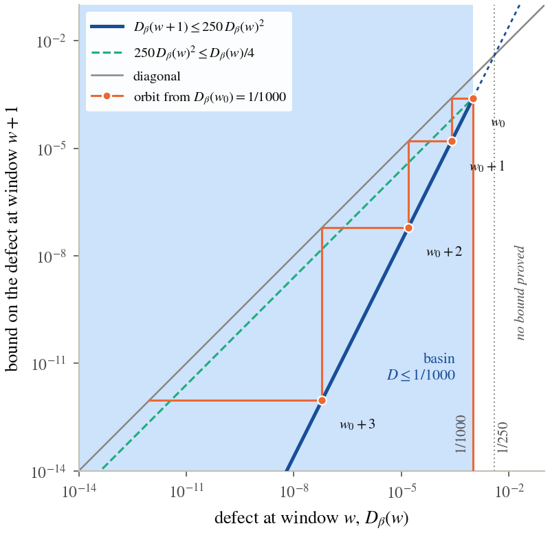

# 5. The doubling defect and its bootstrap

Every statement of this section holds for $SU(N)$, $N\ge1$, and, where marked, for every compact gauge group; the periodic-gap statements need $N\ge2$. None is a statement at large $\beta$: the bootstrap turns a seed into vanishing and produces no seed. The bootstrap is the known purity bootstrap, the squaring of a thermal Rényi-2 entropy under doubling, from OpenAI's two-dimensional $O(3)$ and $O(4)$ work [OAI-O3], [OAI-O4], OpenAI's proof of the periodic spin-one Haldane gap [OAI-Haldane] and Grover's extensions of that proof [Grover]; we do not claim it, and this section supplies its four-dimensional bookkeeping (section 1.6).

## 5.1 The defect and the trace facts

Let $F(v)=\log Z$ on the torus with sides $2^{v_\mu}n$, $v\in\mathbb N^4$ (the corner function), $p_\mu(v)=2F(v)-F(v+e_\mu)$ and $D(v)=16F(v)-F(v+\mathbb 1)$. The torus of twice the side has sixteen times the volume, so $D$ cancels every bulk and local term exactly and leaves a finite-size free energy. Along every monotone path,
$$
D(v)=\sum_{k=0}^32^{3-k}\,p_{\mu_k}(v+e_{\mu_0}+\dots+e_{\mu_{k-1}}).\tag{5.1}
$$
With the transverse sides fixed, $Z=\operatorname{Tr}K^m$ for the transfer along $\mu$, and $p=-\log\operatorname{Tr}\varrho^2$ with $\varrho=K^m/\operatorname{Tr}K^m$: the defect is a weighted sum of Rényi-2 entropies of Gibbs states of spatial tori (the trace identities are proved; the density-operator reading is argued). It counts every gauge-invariant state, electric-flux and torelon states included; a correlator can show that the states it sees are heavy but cannot bound the trace from above.

The transfer kernel between slices is $k(V,V')=e^{-\beta s(V)/2}\int e^{-2\beta t(A,V,V')}dA\,e^{-\beta s(V')/2}$, symmetric, jointly continuous and bounded by $0<k_{\min}\le k\le1$; integrating the time-like links is the Gauss-law projection, and no gauge is fixed.

> Theorem 5.1 (trace identity). For every compact gauge group, $\beta\ge0$ and an even extent $L_\mu=2j$, $Z=\operatorname{Tr}K^{2j}$, the squared Hilbert–Schmidt norm of the $j$-fold kernel.

> Theorem 5.2 (the trace facts). $K$ has a unit eigenfunction with eigenvalue of modulus $\lambda=\|K\|>0$, and for even $m$ there is $s_m\ge0$ with (a) $\operatorname{Tr}K^m=\lambda^m(1+s_m)$, (b) $\operatorname{Tr}K^{2m}\le\lambda^m\operatorname{Tr}K^m$, (c) $\operatorname{Tr}K^{2m}\le\lambda^{2m}(1+s_m^2)$, (d) $\operatorname{Tr}K^{2m}\ge\lambda^{2m}$, (e) $\operatorname{Tr}K^{4m}\ge\lambda^{4m}$; the same at every corner, in every direction, for every compact group.

No trace-class theory is used: the trace of an even power is the cyclic integral, the top eigenvector comes from a Rayleigh-maximizing sequence made equicontinuous by compactness, and even powers make the sign of the remainder irrelevant.

> Theorem 5.3 (positivity and regularity). For even $n\ge2$, $\beta\ge0$: every one-direction defect is non-negative, $8p_\mu\le D$, and $p\le\tfrac14$ gives $p(2m)\le4p(m)^2$; $D_\beta(w)\ge0$ for $w\ge1$, $D_0\equiv0$, and $\beta\mapsto D_\beta(w)$ is continuous and differentiable.

## 5.2 Squaring and the four-dimensional recursion

> Theorem 5.4 (one-direction squaring). Under the trace facts, with $p(m)=2\log a(m)-\log a(2m)$: $0\le p(m)$, $s\le e^{p(m)}-1$, $p(2m)\le2s^2$; if $p(m)\le\tfrac14$ then $s\le2p(m)$ and $p(2m)\le4p(m)^2$; if $p(m)\le\tfrac1{100}$ then $p(2m)\le\tfrac{41}{20}p(m)^2$.

> Theorem 5.5 (the sharp recursion). At every corner, for every compact group with the same constants: (i) $D(v)\le\tfrac1{1000}$ gives $D(v+\mathbb 1)\le250\,D(v)^2$; (ii) $250\,D(0)\le\tfrac14$ gives $250\,D(k\mathbb 1)\le(\tfrac14)^{2^k}$; (iii) $D(0)\le\tfrac1{1000}$ bounds the excited weight in direction $0$ on the torus of corner $k\mathbb 1$ by $(\tfrac12)^{2^k}$.

Idea: the corner identity $p_\mu(c+2e_\nu)=2p_\mu(c+e_\nu)-2p_\nu(c+e_\nu)+p_\nu(c+e_\mu+e_\nu)$, applied six times, raises the needed one-direction defects to at most $2.003\varepsilon$, $4.015\varepsilon$ and $8.07\varepsilon$, each below $\tfrac1{100}$; squaring each by Theorem 5.4 gives $\tfrac{41}{20}(8+4(2.003)^2+2(4.015)^2+8.07^2)\varepsilon^2\le250\varepsilon^2$.

## 5.3 One window gives vanishing and a gap

> Theorem 5.6 (the basin). If $\beta\ge0$, $w\ge1$ and $D_\beta(w)\le\tfrac1{1000}$, then $D_\beta(w+1)\le250\,D_\beta(w)^2\le\tfrac14D_\beta(w)$, $D_\beta(w+i)\le\tfrac1{1000}4^{-i}$ and $D_\beta(w')\to0$; a seed at an even side climbs every dyadic side, for every compact group.

Figure 5.1. The doubling bootstrap on logarithmic axes. In the basin $D\le1/1000$ (shaded) the next window's defect is at most $250D^2$ (solid), at most a quarter of $D$ (dashed); the cobweb from the edge of the basin decays doubly exponentially. Outside the basin no bound is proved; the fixed point $1/250$ lies there.

> Theorem 5.7 (the gap on every dyadic torus). If $D_\beta[n]\le\tfrac1{1000}$ for an even $n\ge2$, then on every cubic torus of side $2^kn$ the transfer $K$ in direction $0$, on all of $L^2$ of the slice, has a unit eigenvector $\psi$ with eigenvalue of modulus $\|K\|$, and $\|K^nf\|\le\tfrac12\|K\|^n\|f\|$ for $f\perp\psi$: a gap of at least $\log2/n$ per step, uniform in the torus size, in every sector.

The periodic state is a limit along an ultrafilter refining the filter of power-of-two sides, so the family $\{2^kn\}$ of a power-of-two seed is one of its sets (no filter forcing divisibility by $3$ contains the power-of-two sides, so the choice is load-bearing). Its periodic transfer $T_\beta$ acts on the reconstruction of the half-space algebra and is a different operator from $K$.

> Theorem 5.8 (the periodic gap from one window). Let $N\ge2$. (i) A power-of-two seed $D_\beta[n]\le\tfrac1{1000}$ makes every gauge-invariant half-space pairing at lag $n$ at most $\tfrac12$ its value at lag $0$ plus $\varepsilon$, eventually along the ultrafilter ($N\ge1$). (ii) If $D_\beta(w)\le\tfrac1{1000}$, $T_\beta$ is self-adjoint with $1$ the largest point of its spectrum, spectrum in $\{1\}\cup[0,r]$, $r=2^{-1/2^w}$, contracts the non-zero vacuum complement by $r$. (iii) If $D_\beta(w)\to0$ the same holds at some $r\in(0,1)$.

The closing error of (i) needs the excited weight of each torus, which the operator gap of Theorem 5.7 does not bound; the hypothesis is the seed.

## 5.4 The bridge (S) and its forms

(S) asks that, for every $B$, the defect vanish at some $\beta\ge B$; it is the weakest form Theorem 1.1 consumes. Let $Y_\beta(w)=\max_i(\|R_i\|/\lambda_i)^{2^w}\in[0,1)$ be the window read, the largest excited ratio of the transfers $K_i$ on the step slices of the corner path at the window's own time, with $\lambda_i$ the top eigenvalue, $\psi_i$ its eigenvector and $R_i=K_i-\lambda_i\psi_i\otimes\psi_i$ the remainder.

> Theorem 5.9 (equivalent forms). Let $N\ge1$, $\beta\ge0$. (i) The defect vanishes at $\beta$ exactly when some window has $D_\beta(w)<\tfrac1{1000}$, when it contracts by a fixed fraction from some window on, and when it is bounded along the windows with $Y_\beta(w)\to0$. (ii) It fails to vanish at $b$ exactly when the seed window diverges at $b$. (iii) (S) holds exactly when, frequently as $\beta\to\infty$, some window has $D_\beta(w)\le\tfrac1{1000}$. (iv) For $N\ge2$ and $0<u_0\le\tfrac1{1000}$, (S) holds exactly when a coupling tower at $u_0$ exists.

The everywhere form (vanishing at every $\beta\ge0$) is stronger than (S); a bulk phase-coexistence point at one coupling would contradict it without contradicting (S) (argued).

> Theorem 5.10 (the basin grows when the read changes at a bounded rate). Let $N\ge1$. Suppose that, for couplings $\beta_0$ arbitrarily close to $0^+$, there is $K>0$ with $|\partial_\beta D_\beta(w)|\le K\,D_\beta(w)\log(1/D_\beta(w))$ whenever $\beta\ge\beta_0$, $w\ge1$ and $D_\beta(w)\le\tfrac1{1000}$. Then the defect vanishes at every $\beta\ge0$; in particular (S) holds.

The proof reads the scale from the signal. If window $k$ is in the basin on $[\beta_0,b]$, squaring puts window $k+1$ at most at $\tfrac1{4000}$ there, and the bounded rate keeps it in the basin for a further $c=\log(\log4000/\log1000)/K$ in $\beta$; so the basin edge grows by $c$ per window and every coupling is reached. The base on $[0,\beta_0)$ is the strong-coupling anchor. For $N\ge2$ the bound cannot hold from $\beta_0=0$: the defect is $0$ at $\beta=0$, and $D\log(1/D)$ would then hold it at $0$ for ever, against the weak end (Theorem 5.14). On a family $D=e^{-m\,2^w}$ the condition is exactly $|m'|\le K m$: a bounded lattice beta function, read at the window. It fails for $U(1)$ at its transition (argued). By Hellmann–Feynman it asks the action excess of the lightest excitation to be at most a fixed multiple of its energy at every scale from the lattice spacing to the correlation length, which is asymptotic scaling and is not proved (argued).

## 5.5 The fork

> Theorem 5.11 (Perron–Frobenius with an explicit gap). For every compact group, $\beta\ge0$ and slice, the transfer has a strictly positive top eigenfunction and $\|R\|\le\lambda-k_{\min}\lambda^2$; hence $0\le Y_\beta(w)<1$.

The gap of Theorem 5.11 is of order $e^{-\beta M}$, $M$ proportional to the slice volume: nothing uniform.

> Theorem 5.12 (the fork). For every compact group, $\beta\ge0$, $w\ge1$: $D_\beta(w+1)\le30\,Y_\beta(w)(e^{8D_\beta(w)+2D_\beta(w+1)}-1)$ and $Y_\beta(w)\le e^{8D_\beta(w)+2D_\beta(w+1)}-1$; so $D_\beta\to0$ exactly when $D_\beta$ is bounded along the windows and $Y_\beta\to0$.

> Theorem 5.13 (what a stall is). If $0<s\le D_\beta(w)\le A$ eventually, then eventually $s/(30(e^{10A}-1))\le Y_\beta(w)<1$, and either $Y$ comes frequently within every $\delta$ of $1$ or stays eventually below $1-\delta$; if $Y_\beta(w)\le e^{-\mu2^w}$ and $D_\beta(w)\ge s>0$ eventually, then eventually $8D_\beta(w)+2D_\beta(w+1)\ge\mu2^w+\log(s/30)$.

A stall therefore has one of three shapes: (H) an unbounded defect, forced if the lattice mass on the step slices is positive; (Q) a bounded defect with $Y$ frequently near $1$, a quasi-degenerate level; (Σ) a bounded defect with $Y$ eventually in $[c_0,1-\delta]$, a lowest level at gap of order $2^{-w}$ (the massless shape). (Σ) occurs in four-dimensional $U(1)$ at large $\beta$ [Guth], [FrohlichSpencer]; (Q) is expected for a finite group without centre and at an isolated bulk phase-coexistence point (argued). The fork classifies; it excludes nothing.

## 5.6 The two ends

> Theorem 5.14 (the weak end). Let $N\ge2$. For every $j\ge1$, eventually as $\beta\to\infty$, $D_\beta[2j]>\tfrac1{1000}$; in particular, for every $w$ and $u_0\le\tfrac1{1000}$, frequently $D_\beta(w)>u_0$.

Idea: the centre $\mathbb Z_N^2$ acts on a slice as 't Hooft's twists [tHooft]; at each slice configuration either a charged word of the Polyakov holonomies has trace above $\tfrac12$, so the twisted row is exponentially small, or a commutator floor makes the spatial action positive; with a lower bound $Z\ge c_\eta e^{-\beta\eta}$ this gives $\|a\ast a\|_{HS}^2\le\tfrac34\|a\|_{HS}^4$, a one-direction defect at least $\log\tfrac43$. So a seed at large coupling, if it exists, sits at a side growing without bound with $\beta$; the same argument applies to $U(1)$ (argued).

> Theorem 5.15 (the anchor, openness, the least stall). Let $N\ge1$. The defect vanishes on some $[0,\beta_0)$, $\beta_0>0$ (with a periodic gap for $N\ge2$); the vanishing set is relatively open; if vanishing fails somewhere there is a least such coupling; uniform smallness on $[0,b)$ gives vanishing at $b$; and vanishing everywhere holds exactly when there is no least stall point, and implies (S).

Section 7 shows the anchor interval contains $[0,1/500000]$. Openness and the anchor alone do not give (S): the read "$\beta<1$" is open, anchored and false at every large $\beta$.

## 5.7 The seed against the running spacing

The seed at a side of fixed physical size against the two-loop running spacing is stronger than (S) and is the gap input of the two-loop capstones (Theorem 4.16). For $\ell_0>0$ let $n_P(\beta)$ be the least power of two with $n_Pa(\beta)\ge2\ell_0$.

> Theorem 5.16 (the fixed window). If $D_\beta[n_P(\beta)]\le1/1000$ at every large $\beta$, the periodic family has fixed-window decay at window $5\ell_0$ with ratio $\tfrac12$.

> Theorem 5.17 (the seed at the running spacing). Some $\ell_0>0$ has $D_\beta[n_P(\beta)]\le1/1000$ at every large $\beta$ if and only if some $C$ has, at every large $\beta$, a power of two $n$ with $na(\beta)\le C$ and $D_\beta[n]\le1/1000$; a bounded defect at physical sizes below $s_0$ together with a descent gives it.

Bałaban's analysis [Balaban87], [Balaban89b] controls objects of the bounded-defect kind on block lattices up to a physical size where the running coupling is still small; it does not reach correlation functions.

> Theorem 5.18 (the defect-length tower). Let $N\ge2$. If at every large $\beta$ some power-of-two side is a seed and every side frequently is not, there are couplings $\beta_b\to\infty$ at which $2^b$ is not a seed and $2^{b+1}$ is, and at each the periodic transfer has $-\log r_b\ge\log2/2^{b+1}$: at spacing $\ell_0/2^{b+1}$, a mass at least $\log2/\ell_0$.

This is the analogue of normalizing by the theory's own correlation length [OAI-O3]: the gap clause alone holds at $\beta=0$, and what makes the tower the theory's own is that the seed side grows.

> Theorem 5.19 (the observer's gap from the seed). For every flow with the uniform bound and a physical range, the seed at the running spacing with constant $C$ gives the observer's transfer gap at every step at rate $\exp(-(c/5C)a_{m_0})$; the observer's clustering on the time grid is the same statement as one gap at one step.

## 5.8 The flux sectors and the physical side

On every slice the centre $\mathbb Z_N^3$ acts by multiplying the transverse links through one plane; its zero-flux sector is $a_0(x,y)=N^{-3}\sum_ga(x,gy)$. Each corner step carries the flux share $1-N^{-3}\sum_gZ_g/Z$ (the mean deficit of 't Hooft's electric-flux twists [tHooft]) and the zero-flux defect (the glueball part of the light-state count).

> Theorem 5.20 (the flux sectors). (i) "At every large $\beta$ some power-of-two side is a seed" holds exactly when, eventually, some such side has flux share and zero-flux defect at most $1/80000$ on all four steps; (ii) time doubling acts on the zero-flux sector alone; (iii) the flux share of the time-doubled torus is at most $(f/(1-f))^2e^{\text{zero-flux defect}}$; (iv) at $SU(2)$ every twist deficit is at most $8$ times the flux share; (v) below $\varepsilon_0(N)=1/(2812500(N^3+4))$ at one side, both reads stay below $\varepsilon/4^k$ at side $2^kn$.

The squaring of (iii) uses only positivity, symmetry and centre invariance, so it holds for $U(1)$, $\mathbb Z_2$, Georgi–Glashow and Banks–Zaks and carries no confinement. The two parts are independent (literature or argued): the Coulomb phases of $U(1)$ and Georgi–Glashow fail both; four-dimensional $\mathbb Z_2$ above $\beta_c$ fails the flux part only; Banks–Zaks fails both. The mixed fundamental–adjoint action has a first-order line ending at a point [BhanotCreutz]; for $SU(3)$, Heller finds the $0^{++}$ mass falling toward the endpoint while the string tension and the other masses do not [Heller], a case where the flux part holds and the zero-flux part fails.

For $SU(2)$ and $L>0$ let $n_L(\beta)=2^{\lfloor\log_2(L/a(\beta))\rfloor}$, so $L/2<n_La\le L$, and consider (V) the vortex free energy $-\log z_R$ of every plane and residual sheet at most $1/720000$, and (F0) the zero-flux defects of the four steps at most $1/80000$, both at $n_L(\beta)$ eventually in $\beta$.

> Theorem 5.21 (the seed as vortex free energies). At $SU(2)$ the seed at the running spacing holds if and only if some $L>0$ has (V) and (F0).

> Theorem 5.22 (the flux half is electric flux). At $SU(2)$ the twist deficit is twice the odd-electric-flux trace, $1-z_R=2\,\mathrm{oddFlux}/Z$, so the odd-to-even ratio $E$ satisfies $E\le1-z_R\le2E$; a centre-covariant polymer description with activity $r^{|X|}$, $4225re\le1/128$, gives the flux half; no function of the readings fixes $z_R$; and through the Tomboulis–Yaffe decomposition the flux half gives an area law whose tension tends to $0$ along large boxes.

> Theorem 5.23 (the zero-flux half is a spectrum). A gap $\mu$ above the ground level and a count $\sum_je^{-(E_j-E_0)t_0}\le C$ at one physical time bound the zero-flux defect by $2Ce^{\mu t_0}e^{-\mu na}$; a loop gas gives the count at a fixed physical block size, with the root count growing like $(\ell/b)^d$.

> Theorem 5.24 (restatements of the zero-flux half). One reading carries the zero-flux trace up to a factor $4$ exactly when the defect is small; a tension-and-localization cost $c\sigma R+c'/R$ is the gap clause at $2\sqrt{cc'\sigma}$, no more and no less; the IMS identity holds for every square partition of unity, and a configuration-space size partition cannot give a positive gap.

> Theorem 5.25 (electric loops). Every excited zero-flux level lies in the $L^2$ closure of the Wilson-loop states at $SU(2)$ (Giles' reconstruction and Stone–Weierstrass), and of words of loops at every $N$ (Procesi's separation by traces); diagonal bounds on loop-size shells give the zero-flux gap at half the rate. The diagonal shell bound uniform in $\beta$ is not proved.

> Theorem 5.26 (the kernel input). Conditioning on the outside of a box splits a covariance exactly; a kernel-near bound (the box kernel of an observable within $\delta$ of a constant at every boundary condition) bounds covariances off the box by $2M\delta$ and, through a Dobrushin iteration over blocks of physical size $b$, gives a mass $-\log\alpha/b$; it is proved at $|\beta|\le2^{-16}$.

The zero-flux half thus reduces to a kernel-near bound at one physical scale uniformly in $\beta$: proved at strong coupling, open at weak coupling.

## 5.9 The $SU(2)$ chain

The Migdal–Kadanoff chain from the Wilson weight [Migdal], [Kadanoff] exists at every real $\beta$ and carries the seed on its coarse lattices.

> Theorem 5.27 (the Hölder bond-moving bound). For every compact group, dimension, even side and bounded plaquette density $\varphi$, the torus partition function at $\beta\varphi$ is at most that of the moved field ($2^{d-2}\beta\varphi$ on plaquettes even in both transverse directions, removed otherwise), with no constant; twisted fields invariant along the moved directions likewise.

> Theorem 5.28 (the exact electric step). The time-like part of the transfer factorizes per link and composes by Haar convolution of the class weights; Haar measure on $SU(2)$ is the normalized ball volume pushed to the sphere; and the moved side-$2n$ torus integrates out to the side-$n$ torus with weight $(w\ast w)\ast(w\ast w)$, for every compact second-countable group.

What remains on this route is that the four-dimensional theory disorders per doubling at least as fast as the chain; at weak coupling the one-loop loss per doubling is $0.2575$ against the chain's $\tfrac14$ (argued). It is not proved.
