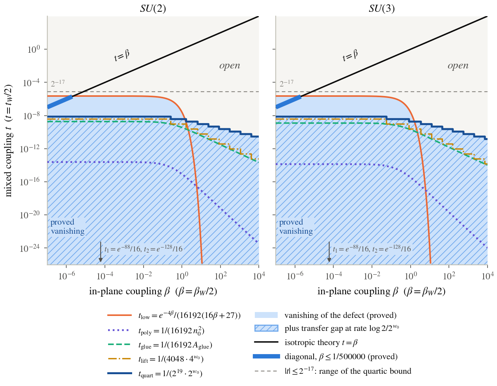
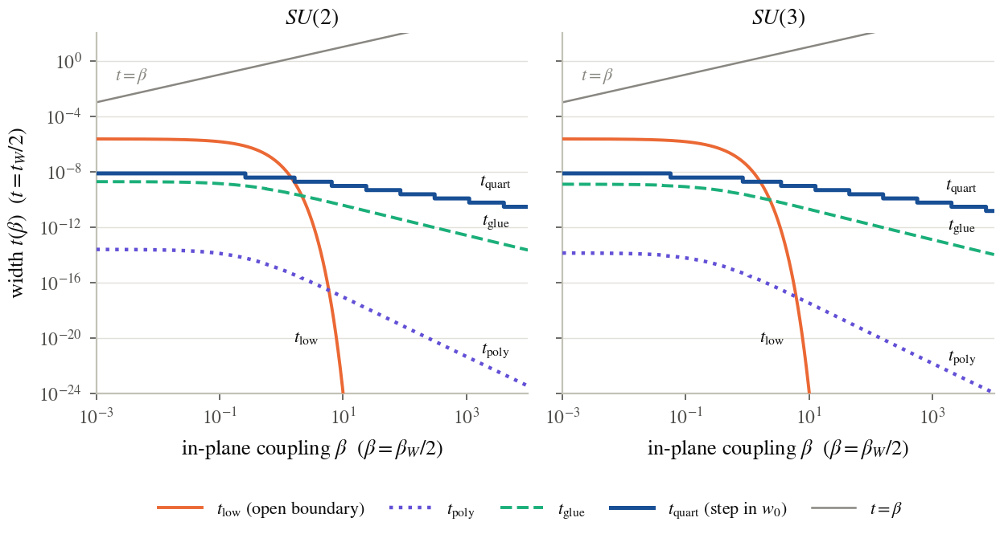

# 7. The decoupled end and the anisotropic strip

The anisotropic family gives the bootstrap somewhere to act. Split the plaquette orientations into in-plane ones (both directions in $\{0,1\}$ or both in $\{2,3\}$) and mixed ones, and put, on the cubic torus of side $n$,
$$
Z(\beta,t,n)=\int e^{-(\beta S_{\mathrm{in}}+t\,S_{\mathrm{mix}})}\prod dU,\qquad D(\beta,t,w)=16\log Z(\beta,t,2^w)-\log Z(\beta,t,2^{w+1}).
$$
The group is $SU(N)$, $N\ge1$, $\varphi(g)=1-\tfrac1N\operatorname{Re}\operatorname{tr}g$. Three facts carry the section: the plane's window is set by a proved bound $\ell_N(\beta)$ on its correlation area (Theorem 7.8); the decoupled read settles at every $\beta$; and a small mixed coupling keeps it settled, below explicit widths that shrink as $\beta$ grows and, away from small $\beta$, never reach the isotropic diagonal $t=\beta$ where (S) lives.

> Theorem 7.1 (the isotropic end and the trace facts). $D(\beta,\beta,w)=D_\beta(w)$; for orientation-dependent couplings $c_{ij}\ge0$ the trace facts and the positivity of section 5 hold in every direction at every corner, so $D(\beta,t,w)\ge0$ for $\beta,t\ge0$; and $(\beta,t)\mapsto D(\beta,t,w)$ is jointly continuous.

## 7.1 The decoupled end

> Theorem 7.2 (the decoupled torus is a product). For every $N$, $\beta$, $n$: $Z(\beta,0,n)=Z_2(\beta,n)^{2n^2}$, the $2n^2$ planes being independent two-dimensional tori. Hence $D(\beta,0,w)=8n^2D_2(\beta,n)$ at $n=2^w$, with $D_2(\beta,n)=4\log Z_2(\beta,n)-\log Z_2(\beta,2n)$.

The face weight $e^{-2\beta\varphi}$ has the floor $f_\beta=e^{-4\beta}$; write $\mathrm{sw}=\mathrm{wt}-f_\beta$, $c_\beta=\int\mathrm{sw}$, $b_\beta=c_\beta+f_\beta$ and $q_\beta=c_\beta/b_\beta\in[0,1)$.

> Theorem 7.3 (a free link). For $n\ge2$, continuous $s:SU(N)\to[0,1]$ and every non-empty proper set $S$ of faces of the two-dimensional torus, $\int\prod_{x\in S}s(\mathrm{face}_xU)\prod dU=(\int s)^{|S|}$.

A proper set has a face with a link entering no other face of the set; Haar invariance integrates it out. This is the lattice form of the independence used since Migdal's recursion [Migdal], proved from Haar invariance alone.

> Theorem 7.4 (the two-dimensional torus). For $n\ge2$, $\beta\ge0$: $Z_2(\beta,n)=b_\beta^{n^2}-c_\beta^{n^2}+R(n)$ with $0\le R(n)\le c_\beta^{n^2-1}$; $|Z_2/b_\beta^{n^2}-1|\le\tfrac{1+c_\beta}{b_\beta}q_\beta^{n^2-1}$; and $n^2D_2(\beta,n)\to0$.

> Theorem 7.5 (the decoupled read settles). $D(\beta,0,w)\to0$ at every $\beta\ge0$.

As $\beta\to\infty$, $q_\beta\to1$: the convergence is not uniform in $\beta$. The proof reads only Haar invariance, $0\le\varphi\le2$ and $\varphi(1)=0$, so the same is expected for every compact group, $U(1)$ included (argued; proved for $SU(N)$): settling at the decoupled end is not a non-abelian effect.

> Theorem 7.6 (the anisotropic basin and the mixed anchor). For $t\ge0$, $D(\beta,t,w)\le\tfrac1{1000}$ gives $D(\beta,t,w+1)\le250D(\beta,t,w)^2$ and vanishing; and there is $b(N,\beta)>0$ with $D(\beta,t,\cdot)\to0$ for every $t\in[0,b)$.

> Theorem 7.7 (a conditional route through analyticity). If, frequently as $\beta\to\infty$, the defects $D(\beta,\cdot,w)$ extend holomorphically to a preconnected domain containing an interval $(0,\varepsilon)$ and the point $\beta$, locally bounded uniformly in $w$, then (S) holds (Vitali).

The analyticity hypothesis is open at every $\beta>0$; for $U(1)$ it is expected to fail through a transition in $t$ on $(0,\beta)$ (argued).

## 7.2 Explicit widths

Write $\ell_N(\beta)=240+150(N+4)\beta$, $J_N(\beta)=\lceil2\sqrt{2N(\beta+1)}\rceil+1$, $E_N(\beta)=1+2N^2\log J_N(\beta)$, $A_{\mathrm{glue}}=2+2\ell(2E+2\log\ell+26)$, $n_0=2+2\ell(2E+41+6\log\ell)$, $w_0=\lceil\log_4A_{\mathrm{glue}}\rceil$ and $\mu_\ast=\log2/2^{w_0}$. The plaquette walk is convolution by $p=e^{-2\beta\varphi}/b_N(\beta)$, with $b_N(\beta)=b_\beta$ the face integral, and $F_k$ is its $(k+1)$-fold power.

> Theorem 7.8 (gap of the plaquette walk). For mean-zero continuous $f$, $\int(Pf)^2\le(1-1/\ell_N(\beta))\int f^2$.

The inequality $\varphi(yh)+\varphi(yh^{-1})\le2\varphi(y)+2\varphi(h)$ has no first-order term, which makes the working scale $1/\beta$ and not $1/\beta^2$; no character expansion or heat kernel is used.

> Theorem 7.9 (equilibration and the bulk). $|F_{m+1}(x)-1|\le e^{-m/(2\ell_N(\beta))}/b_N(\beta)$, and $1/b_N(\beta)\le e^{E_N(\beta)}$.

The plane's working window is $\ell_N(\beta)$, a proved upper bound on the area at which its walk mixes; the window is set by this bound, not by the exact area.

> Theorem 7.10 (the coupling plane). Let $V_N$ be the set of $(\beta,t)\in[0,\infty)^2$ where $D(\beta,t,\cdot)\to0$ and $\Sigma_N$ its complement. (i) $(\beta,t)\in V_N$ exactly when some window has $D\le1/1000$; (ii) $V_N$ is relatively open and $\Sigma_N$ closed; (iii) (S) holds exactly when $(\beta,\beta)\in V_N$ for arbitrarily large $\beta$; (iv) along every continuous path from $V_N$ that meets $\Sigma_N$ there is a first stall point; (v) $(\beta,0)\in V_N$ for every $\beta$, and every vertical segment $\{\beta\}\times[0,\beta]$ that meets $\Sigma_N$ has a least stall $t_\ast\in(0,\beta]$.

> Theorem 7.11 (quadratic cost). For $w\ge1$, $D(\beta,t,w)\le D(\beta,0,w)+8192\cdot16^wt^2$; so $D(\beta,0,w)\le1/2000$ and $t\le1/(4048\cdot4^w)$ give vanishing.

Idea: colouring the mixed plaquettes by parities makes those of one colour independent and Haar distributed under the in-plane measure; Hoeffding's lemma [Hoeffding] bounds the generating function, and the bulk term cancels between the two tori.

> Theorem 7.12 (the decoupled seed). $D(\beta,0,w)=8\cdot4^w(4\log\rho(2^w)-\log\rho(2^{w+1}))$ with $\rho(n)=Z_2(n)/b_N^{n^2}$; a sup bound on $F_m$ bounds $\rho$ row by row; gluing the rows into one cyclic chain gives $|\rho(k+2)-1|\le e^{-((k+2)^2-2)/(2\ell_N)}/b_N$; hence $A_{\mathrm{glue}}\le4^w$ gives $D(\beta,0,w)\le1/2000$.

With $t_{\mathrm{low}}=e^{-4\beta}/(16192(16\beta+27))$, $t_{\mathrm{coh}}=1/(16192(1+b_Ne^{4\beta}(16\beta+26)))$, $t_{\mathrm{poly}}=1/(16192n_0^2)$ and $t_{\mathrm{glue}}=1/(16192A_{\mathrm{glue}})$:

> Theorem 7.13 (the strip of vanishing). $D(\beta,t,\cdot)\to0$ for $0\le t<t_{\mathrm{low}}$ (a width independent of $N$), for $t\le t_{\mathrm{coh}}$, $t\le t_{\mathrm{poly}}$, $t\le t_{\mathrm{glue}}$, $t<\max(t_{\mathrm{low}},t_{\mathrm{poly}})$, and on the diagonal at $\beta\le1/500000$.

> Theorem 7.14 (comparisons). $t_{\mathrm{low}}\le t_{\mathrm{coh}}$; $t_{\mathrm{poly}}\le1/(16192(300(N+4)\beta)^2+16192)$; $t_{\mathrm{poly}}\le t_{\mathrm{glue}}\le1/(16192(7800(N+4)\beta+2))$.

The diagonal range is far inside the classical strong-coupling regime [OsterwalderSeiler].

## 7.3 The quartic cost

With $H(s)=\int e^{s(\varphi-\langle\varphi\rangle)}dg$ and $\mathcal l(t)=4\log H(-2t)-8t\langle\varphi\rangle$ (a function of $t$ and $N$ only):

> Theorem 7.15 (extensive $\log Z$). For even $n\ge4$, real $\beta$ and $|t|\le2^{-17}$, $|\log Z(\beta,t,n)-\log Z(\beta,0,n)-n^4\mathcal l(t)|\le48\cdot2^{52}n^4t^4$.

> Theorem 7.16 (quartic cost). $|D(\beta,t,w)-D(\beta,0,w)|\le6\cdot2^{60}16^wt^4$ for $|t|\le2^{-17}$ and $w\ge2$, uniformly in $\beta$ and $N$; so $t\le1/(2^{19}2^w)$ at a decoupled seed gives vanishing, and $t_{\mathrm{quart}}=1/(2^{19}2^{w_0})\ge2^{-20}A_{\mathrm{glue}}^{-1/2}$, $t_{\mathrm{glue}}\le t_{\mathrm{quart}}$.

Idea: tilt the mixed plaquettes to Haar mean zero and control $Z(A\cup\{p\})/Z(A)$ by induction on $|A|$ (a Dobrushin-type recursion [Dobrushin68b], [Dobrushin70] on the integral itself); a corner of $p$ read by no other factor centres it out at every $\beta$, so on the two-step neighbourhood the error per plaquette is of order $t^4$.

> Theorem 7.17 (dependency-graph bound). If $|X_p|\le M$, each $X_p$ is independent of every family outside a neighbourhood of size at most $k$, and $16k|z|M\le1$, then $|\log\mathbb Ee^{zS}-\sum_p\log\mathbb Ee^{zX_p}|\le192|I|kz^2M^2$.

This is a real-variable form of [Janson], [FMN], re-proved and not used as an input.

## 7.4 The size-uniform transfer gap

Let $K_\mu$ be the transverse transfer of the anisotropic torus of side $2^w$ on $L^2$ of the slice.

> Theorem 7.18 (transfer gap inside the glued strip). For $0\le t\le t_{\mathrm{glue}}$, every $\mu$ and $w\ge w_0$, $K_\mu$ has a unit eigenvector $\psi$ with eigenvalue of modulus $\|K_\mu\|$ such that $\|K_\mu^rf\|\le2e^{-\mu_\ast r}\|K_\mu\|^r\|f\|$ for $f\perp\psi$ and every $r\ge0$; the rate does not depend on $w$; and the normalized $2^{w_0}$-step transfer clusters at rate $2^{-k}$ after $k$ steps about a vacuum vector of its data.

> Theorem 7.19 (a seed gives a gap). A window with $D(\beta,t,w)\le1/1000$ gives the gap at rate $\log2/2^w$ from window $w$; every point of $V_N$ carries such a gap; with $t_{\mathrm{lift}}=1/(4048\cdot4^{w_0})$, $t_{\mathrm{glue}}\le t_{\mathrm{lift}}\le4t_{\mathrm{glue}}$ and the gap at rate $\mu_\ast$ holds for $t\le t_{\mathrm{lift}}+\varepsilon$ and for $t\le t_{\mathrm{quart}}$; one window serves a whole closed vertical segment in $V_N$; the diagonal carries it near $\beta=0$ and at $\beta\le1/500000$; and along each vertical segment the gap persists up to the first stall, at one rate on each closed sub-segment.

Figure 7.1. The coupling plane, in-plane $\beta$ against mixed $t$, for $SU(2)$ and $SU(3)$. Filled: the proved region of vanishing below the envelope of $t_{\rm low}$, $t_{\rm poly}$, $t_{\rm glue}$, $t_{\rm lift}$, $t_{\rm quart}$; hatched: where the gap holds at the explicit rate $\mu_\ast$. The black line is $t=\beta$; its thick segment $\beta\le1/500000$ is proved. The dashed line $t=2^{-17}$ bounds the range of Theorems 7.15 and 7.16; the arrow points to $t_1$, $t_2$ of Theorems 7.21 and 7.22, below the plotted range. Every width divided by $\beta$ tends to $0$ as $\beta\to\infty$.

Figure 7.2. The proved widths against $\beta$ for $SU(2)$ and $SU(3)$: $t_{\rm low}$ decays like $e^{-4\beta}$; $t_{\rm glue}$ and $t_{\rm quart}$ polynomially, $t_{\rm poly}$ faster (rates read off the closed forms); $t_{\rm poly}\le t_{\rm glue}\le t_{\rm quart}$ at every $\beta$ (Theorems 7.14, 7.16). On the plotted range none reaches $t=\beta$ (grey).

Read off the closed forms (not theorems except the bounds of Theorems 7.14, 7.16 and 7.19), $t_{\mathrm{poly}}$, $t_{\mathrm{glue}}$ and $t_{\mathrm{quart}}$ are of order $(N^3\beta\log\beta)^{-2}$, $^{-1}$ and $^{-1/2}$. The gap is for the $L^2$ transfer form of finite dyadic tori of the anisotropic theory, at a rate shrinking with $\beta$; it is not shown to be a gap of gauge-invariant correlations.

## 7.5 Toward a strip of constant width

> Theorem 7.20 (any rate suffices). If $|D(\beta,t,w)-D(\beta,0,w)|\le1/2000$ for infinitely many $w$, the defect vanishes and some window carries the gap; that hypothesis holds exactly when $D(\beta,t,w)-D(\beta,0,w)\to0$; and a bound $|\partial_sD(\beta,s,w)|\le Ks^3$ on $[0,t]$ gives $|D(\beta,t,w)-D(\beta,0,w)|\le Kt^4/4$.

A constant-width strip would follow from one open inequality: a $\tau>0$ such that for all $N$, $\beta$, $t\le\tau$ and infinitely many $w$ the mixed cut energy obeys that cubic bound with $Kt^4\le1/500$. The route has two layers: rotating the low links by Haar site variables makes the tilted mixed plaquettes a finite-range system with conditional integral $\mathcal Y(U)$, and $\mathcal Y$ is then averaged against the decoupled measure. Let $t_1=e^{-88}/16$, $t_2=e^{-128}/16$.

> Theorem 7.21 (the site gas given the links). For $|t|\le t_1$ and fixed links, the site polymers of $\mathcal Y(U)$ meet a criterion of Kotecký–Preiss type [KoteckyPreiss] (with its consequences proved by a Dobrushin-type recursion), $\mathcal Y(U)>0$, $\log\mathcal Y(U)=\sum_xy_x(U)$ with $|y_x|\le1$ and local approximations at rate $(65/e^5)^r$, and the tilted gas equals $\int e^{-\beta S_{\mathrm{in}}}\mathcal Y\,dU$.

> Theorem 7.22 (translation-covariant local terms of order $t^4$). For even $n\ge4$ and $0<|t|\le t_2$, the enumeration average $y^S_x$ is translation covariant, $|y^S_x|\le\Lambda(t)=(16|t|)^4e^{512}$, with oscillation bounds decaying like $e^{-10r}$.

> Theorem 7.23 (the plane forgets its torus). On the two-dimensional torus, a continuous non-negative function of an $r\times r$ rectangle has its mean within the relative factor $1-\delta_n$, $\delta_n=(1-e^{-4\beta})^{n^2-r^2}$, of the free-rectangle mean; separated rectangles (each with its ring disjoint from the others) are independent up to $1-\delta$.

> Theorem 7.24 (the ratio as a plane average). $Z(\beta,t,n)/Z(\beta,0,n)=e^{n^4\mathcal l(t)}\,\mathbb E_n[\exp\sum_xy^S_x]$, the average under the product of the plane measures, for all real $\beta$, $t$ and every $n$.

The identity estimates nothing. The second layer needs regularity of $y^S_x$ on scale $1$ and a pointwise local limit theorem for the plaquette walk at every area up to $\beta$ (argued); at $U(1)$ the same route is expected to work by a Dobrushin condition uniform in $\beta$, so even a constant-width strip would not separate the groups, and it would cover only $t\le\tau$, not $t=\beta$.

> Theorem 7.25 (the $U(1)$ facts). For compact $U(1)$ the anisotropic torus, its defect and $D(\beta,\beta,w)=D_\beta(w)$ are formalized; character orthogonality on product Haar; the integer-current representation $\int\prod_p\mathrm{hol}_p^{k_p}=[\operatorname{div}k=0]$; the Fourier coefficients of the faces of a plane; and the Bianchi identity of a three-cube.

The four further steps that would carry the constant-width route to $U(1)$, and the port of the anisotropic chain to $U(1)$, are not done.
